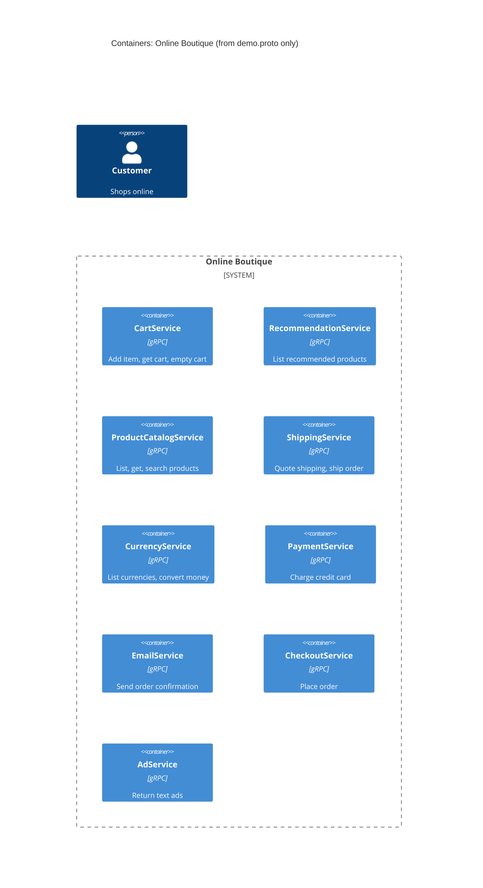

# Task 1, run A: Recovered architecture

Evidence allowed: `system/online-boutique/protos/demo.proto`

## 1. Agent

Claude Code, model Claude Sonnet 5.5 (`claude-sonnet-5-5`).

## 2. Files read

- `prompts/1-recover-architecture.md` (task file)
- `AGENTS.md`, `CLAUDE.md` (rules, loaded automatically)
- `README.md` (student's context; read to find the task, not used as architecture evidence)
- `system/online-boutique/protos/demo.proto` (the only evidence file)

## 3. Containers table

The proto file defines gRPC service contracts (package `hipstershop`). Each `service` is taken as one container. It shows contracts only, not deployment units, languages or data stores.

| Name | Technology / language | Responsibility | Evidence |
|---|---|---|---|
| CartService | gRPC (language Not evidenced in the provided files) | Add item to cart, get cart, empty cart | `demo.proto` `service CartService` (`AddItem`, `GetCart`, `EmptyCart`) |
| RecommendationService | gRPC (language Not evidenced) | List recommended product IDs for a user | `demo.proto` `service RecommendationService` (`ListRecommendations`) |
| ProductCatalogService | gRPC (language Not evidenced) | List, get and search products | `demo.proto` `service ProductCatalogService` (`ListProducts`, `GetProduct`, `SearchProducts`) |
| ShippingService | gRPC (language Not evidenced) | Quote shipping cost, ship an order and return a tracking ID | `demo.proto` `service ShippingService` (`GetQuote`, `ShipOrder`) |
| CurrencyService | gRPC (language Not evidenced) | List supported currencies, convert `Money` | `demo.proto` `service CurrencyService` (`GetSupportedCurrencies`, `Convert`) |
| PaymentService | gRPC (language Not evidenced) | Charge a credit card, return a transaction ID | `demo.proto` `service PaymentService` (`Charge`) |
| EmailService | gRPC (language Not evidenced) | Send order confirmation email | `demo.proto` `service EmailService` (`SendOrderConfirmation`) |
| CheckoutService | gRPC (language Not evidenced) | Place an order (`PlaceOrderRequest` carries user, currency, address, email, card) | `demo.proto` `service CheckoutService` (`PlaceOrder`) |
| AdService | gRPC (language Not evidenced) | Return text ads for given context keys | `demo.proto` `service AdService` (`GetAds`) |

No data store, message broker or external system is evidenced.

## 4. Dependencies table

| Caller → callee | Protocol | Evidence |
|---|---|---|
| None evidenced | n/a | `demo.proto` declares only the services' own RPCs. It does not say who calls them. |

## 5. Mermaid diagram

The diagram matches the tables: nine containers and no dependencies. The `Person` is included as the task requires, but has no `Rel`, because no entry point is evidenced.

## 6. Gaps

| Gap | Extra file that would settle it |
|---|---|
| Who calls each service (all runtime dependencies). `CheckoutService.PlaceOrder` plausibly orchestrates cart, catalog, currency, shipping, payment and email **[Inferred]** from the message types, but nothing proves it. | `system/online-boutique/kubernetes-manifests/checkoutservice.yaml` (address env vars) or `src/checkoutservice/main.go` |
| Whether a web frontend exists, and how the end user reaches the system (no HTTP API in the proto). | `kubernetes-manifests/frontend.yaml`, `src/frontend/` |
| Implementation language of each service. | Each `src/<service>/` folder or its Dockerfile |
| Where cart data is stored (the proto has no store). | `kubernetes-manifests/cartservice.yaml` and the cart service source |
| Whether any external system is involved (e.g. a real payment or email provider). | `src/paymentservice/`, `src/emailservice/` |
| Whether the nine services are separate deployable units. | `kubernetes-manifests/*.yaml` |
